# MeetMind

**AI-powered meeting intelligence and action-item extraction.**

MeetMind is an AI-powered application designed to transform meeting transcripts into structured, actionable tasks. It aims to identify decisions, extract action items, assign priorities and deadlines, and organize responsibilities based on the information discussed during a meeting.

The project is being developed in Python, using Amazon Bedrock for generative AI capabilities and exploring Strands Agents and local decision models for structured task classification.

## Features

- Meeting transcript ingestion.
- Action-item extraction from meeting conversations.
- Task prioritization and classification.
- Assignee and deadline extraction grounded in transcript evidence.
- Structured output validation using Pydantic.
- Human review and editing of generated tasks.
- Task persistence using SQLite.
- Export to JSON and CSV.
- Integrations with project management platforms such as Asana, Trello, and Jira.

## How It Works

MeetMind runs two kinds of "agents" with deliberately different powers:

- **The extraction agent** (Strands Agents + Amazon Bedrock) reads the transcript and writes
  structured results. It has **no tools**: it cannot call APIs, read files or run code.
- **Decider** (a small local classifier, Strands Decider 2B) never writes text. It answers
  yes/no and pick-one questions about each extracted task. It is called from plain Python code,
  never by the LLM, so its contribution can be measured on its own.

Everything between and after them is deterministic code, so a language model's guess is never
the last word.

```mermaid
flowchart TD
    A([Client]) -->|"POST /meetings<br/>or /meetings/upload"| B["Ingestion<br/>parse TXT, VTT, SRT<br/>into segments s0001, s0002, ..."]
    B --> C[("SQLite<br/>meeting + segments")]
    A -->|"POST /meetings/id/process"| D{"Claim meeting<br/>(one run at a time)"}
    C --> D
    D -->|"already running or done<br/>(without force)"| X(["409 Conflict"])
    D -->|claimed| E["Split transcript<br/>into overlapping chunks"]

    subgraph LLM ["Extraction agent (Amazon Bedrock, no tools)"]
        E --> F["Fresh agent per chunk<br/>transcript is untrusted data"]
        F --> G{"Output matches<br/>the schema?"}
        G -->|"no, retry once"| F
        G -->|yes| H["Drop items that cite<br/>segments that do not exist"]
    end

    H --> I["Merge chunks<br/>remove duplicates, keep all evidence"]

    subgraph RULES ["Deterministic validation (no model)"]
        I --> J["Quote must appear in the cited segments"]
        J --> K["Assignee must be named in the quote<br/>or be the speaker"]
        K --> L["Relative dates (tomorrow, a weekday) are recomputed from the<br/>spoken phrase, then checked against the meeting date"]
    end

    L --> M{"Decider<br/>enabled?"}

    subgraph DEC ["Decider (local, second opinion per task)"]
        M -->|yes| N["Is it a task?<br/>Explicit commitment?<br/>Evidence sufficient?"]
        N --> O{"Confident<br/>answer?"}
        O -->|"no or server down"| P["Abstain<br/>(server down: task left untouched)"]
    end

    M -->|no| Q
    O -->|yes| Q["Flag for human review<br/>only when the signal is clearly negative"]
    P --> Q
    Q --> R[("SQLite<br/>tasks, items, run history,<br/>Decider calls")]
    R --> S["Person reviews and edits<br/>PATCH /tasks/id"]
    S --> T(["Export JSON or CSV"])
    R --> T
```



**Reading the diagram**

- **Evidence travels with every item.** Each task and decision keeps a literal quote and the ids
  of the transcript segments it came from. Validation checks that the quote is really there;
  an item that cannot be traced back is flagged (tasks) or removed (decisions, risks, ...).
- **Unknown stays unknown.** An assignee or date the transcript does not support is cleared and
  marked `unknown` instead of being guessed.
- **Rules and Decider only flag or remove, never rewrite.** Doubtful tasks stay visible with
  `needs_review` and the reasons, so a person makes the final call.
- **Failures degrade gracefully.** If Decider is unreachable the pipeline continues without it;
  if the LLM fails, the meeting is marked `failed` and can be processed again.
- **Every run is recorded** (model, tokens, latency, validation counters and each Decider
  answer), which makes it possible to compare runs with and without Decider.

## Tech Stack

| Technology | Purpose |
|---|---|
| Python | Core application logic |
| uv | Dependency and project management |
| boto3 | AWS SDK for Python |
| Amazon Bedrock | Generative AI inference |
| Strands Agents SDK | Agent orchestration and tool integration |
| FastAPI | REST API |
| Pydantic | Data validation and structured outputs |
| SQLite | local persistence |
| pytest | Automated testing |


## Prerequisites

Before running the project, make sure you have:

- Python 3.13 or a compatible version configured for the project.
- [uv](https://docs.astral.sh/uv/).
- An AWS account with access to Amazon Bedrock.
- AWS credentials configured locally.
- Access to a supported Bedrock model or inference profile in your selected AWS region.

## Getting Started

### 1. Clone the repository

```bash
git clone <repository-url>
cd meet-mind
```

Replace `<repository-url>` with the repository's actual URL.

### 2. Install dependencies

```bash
uv sync
```

### 3. Configure AWS credentials

If you use the default AWS CLI profile:

```bash
aws configure
```

Verify your identity:

```bash
aws sts get-caller-identity
```

If you use a named profile, specify it when running AWS CLI commands and configure your application to use the same profile.

### 4. Configure environment variables

Create a local environment file:

```bash
cp .env.example .env
```

Add the required configuration:

```dotenv
AWS_REGION=us-east-1
AWS_PROFILE=default
AWS_BEDROCK_MODEL_ID=us.anthropic.claude-haiku-4-5-20251001-v1:0
```

Use a model ID or inference profile that is available and authorized for your AWS account. The example above uses a regional inference profile; verify its availability before relying on it.

**Security:** Never commit `.env` or expose AWS access keys in source code. Prefer AWS CLI profiles, IAM roles, or another supported credential provider.

### 5. Run the application

```bash
uv run src/meet_mind/main.py
```

This currently runs the initial Bedrock Converse API example. As the project evolves, a package entry point or development server command may replace this command.

## Exporting tasks

`GET /api/v1/meetings/{meeting_id}/export?format=json|csv` downloads the current result of a
processed meeting, including any edits made through `PATCH /api/v1/tasks/{task_id}`. The default
format is JSON; any other value returns `422`, and a meeting that has not been processed returns `409`.

The JSON file contains the meeting metadata plus `summary`, `tasks`, `decisions`, `risks`,
`insights` and `open_questions`, each with its evidence.

The CSV has one row per task, UTF-8 encoded, comma separated, with a header row:

| Column | Content |
|---|---|
| `task_id` | Task identifier, stable across edits |
| `title`, `description` | Task text |
| `assignee`, `assignee_status` | Person and whether it is `explicit`, `inferred` or `unknown` |
| `due_date`, `due_date_status` | ISO date (`YYYY-MM-DD`) and its status |
| `priority` | `low`, `medium`, `high` or `unknown` |
| `review_status` | `pending`, `approved`, `edited` or `rejected` |
| `needs_review` | `true` or `false` |
| `evidence_quotes` | Literal transcript quotes, separated by ` \| ` |
| `evidence_timestamps` | `HH:MM:SS` start time of each quote, in the same order (empty if unknown) |

Unknown values are empty cells. Text that starts with `=`, `+`, `-` or `@` is prefixed with an
apostrophe so spreadsheets show it as text instead of running it as a formula; the original text
follows the apostrophe.

The format is neutral and not tied to any tool. Importing into Asana, Trello or Jira requires a
mapping of these columns to each tool's fields, which MeetMind does not provide.

## Configuration

| Variable | Description |
|---|---|
| `AWS_REGION` | AWS region used by the application |
| `AWS_PROFILE` | Optional AWS CLI profile name |
| `AWS_BEDROCK_MODEL_ID` | Bedrock model ID or inference profile ID/ARN |

The application should use the standard AWS credential provider chain rather than storing credentials directly in configuration files.

## Testing

Run the test suite with:

```bash
uv run pytest
```

As tests are added, the project should cover data validation, task extraction, date and assignee handling, API behavior, persistence, and export functionality.

Model evaluation should also measure extraction accuracy, priority classification quality, unsupported claims, and latency.

### API tests with Postman

`postman/MeetMind.postman_collection.json` exercises the running API end to end, and
`postman/local.postman_environment.json` points it at `http://localhost:8000`. It has three folders:

- **Health:** liveness and readiness.
- **Main flow:** create a meeting, process it, read the results and tasks, edit a task, check the
  edit was persisted, and export JSON and CSV. `meeting_id` and `task_id` are stored in the
  environment while it runs.
- **Error cases:** empty or malformed input, unknown ids, reprocessing without `force`, edits that
  are not allowed, and unsupported export formats.

Start the backend (and the Decider server if it is enabled), then run it from Postman, or from the
terminal with [newman](https://www.npmjs.com/package/newman):

```bash
uv run meet-mind
npx newman run postman/MeetMind.postman_collection.json -e postman/local.postman_environment.json
```

The main flow calls Amazon Bedrock, so it needs valid AWS credentials and takes a few seconds.
The tests check structure and invariants (evidence present, unknown values left empty, edits
persisted) and never exact generated text, because model output varies between runs.

### Evaluating quality

`evals/` measures how good the extraction is and whether Decider helps, using the
[Strands Evals SDK](https://strandsagents.com/docs/user-guide/evals-sdk/quickstart/) to define
cases, evaluators and per-case reports. Every judgement is a comparison with a human label, so no
language model is used as a judge.

```bash
# Extraction quality, with and without Decider (calls Bedrock; needs the Decider server)
uv run python -m evals.run_pipeline_eval --split dev --allow-draft

# Decider on its own, sentence by sentence (free and fast; needs the Decider server)
uv run python -m evals.run_decider_eval --split dev --allow-draft
```

Each run writes `summary.md`, `metrics.json`, the SDK reports and the raw predictions to
`evals/reports/<timestamp>-<kind>/` (git-ignored), together with the models, parameters, dataset
hashes, package versions and git commit that produced them.

- **Labels** live in `evals/datasets/`; read `LABELING_GUIDE.md` before editing them. Rows have a
  status: `template` (empty), `draft` (unverified) or `reviewed` (verified by a person). Only
  `reviewed` rows count unless `--allow-draft` is passed, and templates are never used.
- **Dev and test splits** are separate files. Tune prompts, rules and thresholds on `dev`; use
  `test` only to report results.
- **With vs. without Decider** is measured on the same extraction (the model runs once per meeting),
  because Decider only adds review flags after extraction and validation.
- **Metrics:** task precision, recall and F1; assignee and due-date accuracy on the tasks found;
  how many "not a task" traps the system fell for; how many quotes cannot be found in the transcript;
  how well the review flag points at wrong tasks (including *silent errors*, wrong tasks with no
  flag); and for Decider, accuracy, macro F1, confusion matrix, calibration (ECE, Brier), latency
  percentiles and a coverage-versus-accuracy table for choosing the confidence threshold.

## Design Principles

- **Evidence-based extraction:** Tasks, assignees, deadlines, and decisions should be supported by the meeting transcript.
- **Explicit uncertainty:** Missing or ambiguous information should remain unresolved rather than being invented.
- **Human oversight:** Users should be able to review and edit generated tasks before exporting them.
- **Deterministic validation:** Business rules and schema validation should be enforced in application code.
- **Evaluated model selection:** Generative and decision models should be selected based on measurable quality, cost, latency, and deployment requirements.
- **Modular architecture:** Model providers, task extraction, validation, persistence, and integrations should remain independently testable.

